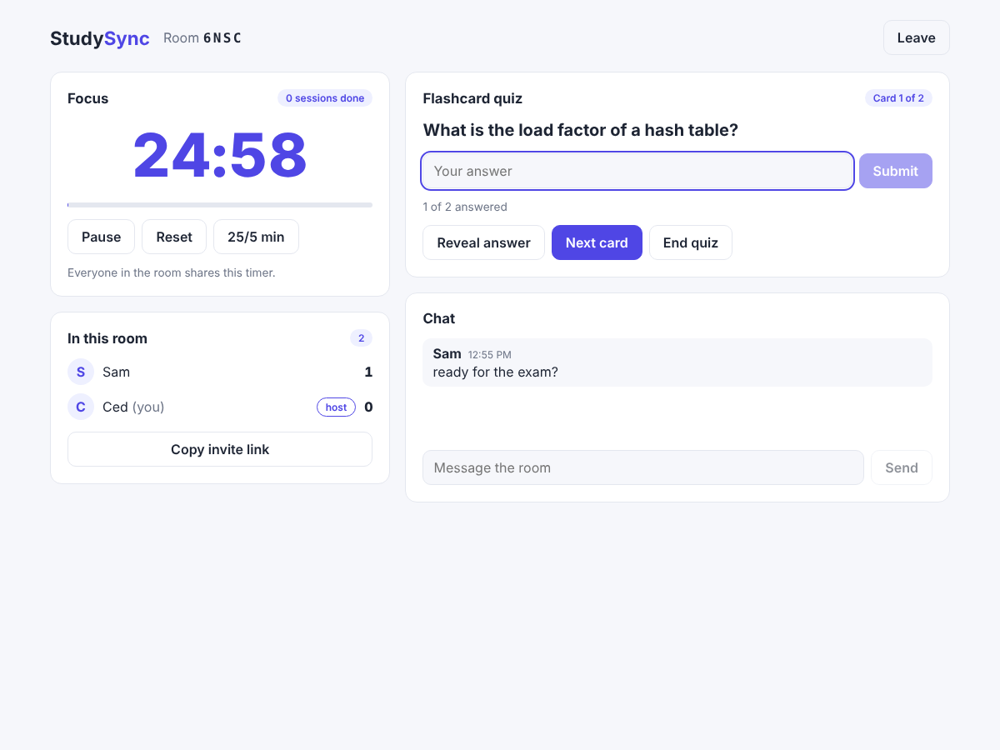
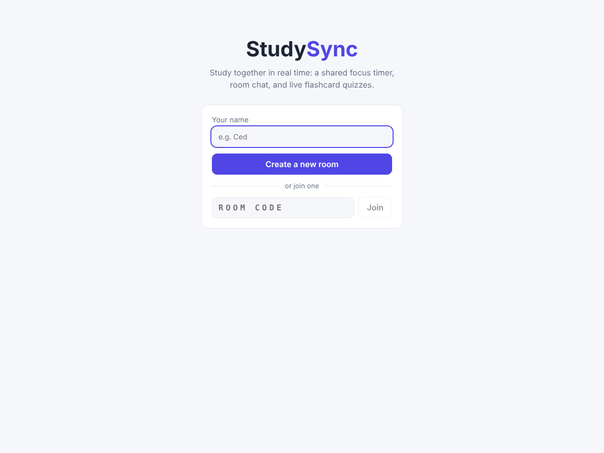
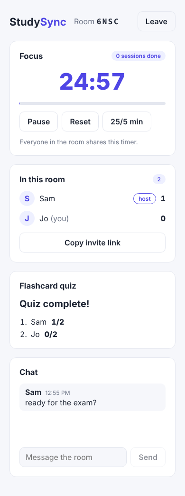
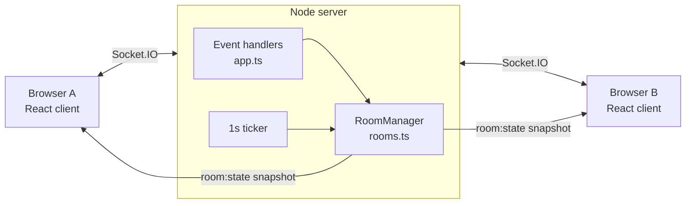

# StudySync

Realtime study rooms for friends and classmates. Create a room, share the 4-letter code, and study together with a **shared Pomodoro timer**, **room chat**, and **live flashcard quizzes** with a scoreboard.



## Features

- **Rooms with short codes.** Create a room, then share the code or an invite link (`/?room=6NSC`). No account needed.
- **Live presence.** See who's in the room as people join and leave. If the host leaves, the role passes to the next person.
- **Shared focus timer.** Start, pause, reset or change the lengths from any device, and everyone sees the same countdown. Focus flows into break automatically, and completed sessions are counted.
- **Room chat** with the last 100 messages kept per room.
- **Flashcard quizzes.** The host builds a deck and runs the quiz. Everyone answers on their own device, answers stay hidden until the host reveals them, and a live scoreboard ranks the room.
- **Auto-reconnect.** If a connection drops, the client rejoins the room automatically.
- **Responsive, with dark mode** that follows your system setting.

| Lobby | Mobile |
| --- | --- |
|  |  |

## Tech stack

| Layer | Tools |
| --- | --- |
| Language | TypeScript end to end, with event types shared by client and server |
| Front end | React 19, Vite |
| Realtime | Socket.IO (WebSockets with fallback) |
| Server | Node.js, Express |
| Tests | Vitest: unit tests for room logic plus end-to-end tests with real socket clients |
| CI | GitHub Actions: typecheck, test and build on every push |
| Deploy | Docker image with a health check, or one-click Render blueprint |

## How it works



Design decisions worth calling out:

- **The server is the single source of truth.** Clients send intents (`timer:start`, `quiz:answer`) and render whatever snapshot the server broadcasts. Nobody can drift out of sync or cheat by editing local state.
- **Timers use timestamps, not ticking counters.** The server stores when the current phase ends (`endsAt`), and each client counts down locally from it, correcting for clock differences with the server's timestamp on every snapshot. A once-a-second server tick only handles phase changes, and it catches up if several phases were missed.
- **Answers never reach the browser early.** Snapshots go through `publicQuiz()`, which strips the current answer until the host reveals it. A test checks that the answer string is absent from the snapshot.
- **Room logic is pure and deterministic.** `rooms.ts` has no sockets or timers; anything time-based takes `now` as an argument. That makes it fast to unit test, and the Socket.IO layer stays a thin wrapper.
- **Input is validated on the server.** Names, messages, cards and timer lengths have length and range limits, and errors return to the sender as readable messages through Socket.IO acknowledgements.

## Getting started

Requires Node.js 20 or later.

```bash
git clone https://github.com/<your-username>/studysync.git
cd studysync
npm install
npm run dev
```

Open http://localhost:5173 in two browser windows, create a room in one and join it from the other.

| Command | What it does |
| --- | --- |
| `npm run dev` | Runs the server (port 3001) and the Vite client (port 5173) with hot reload |
| `npm test` | Runs all server tests |
| `npm run typecheck` | Type-checks the client, server and tests |
| `npm run build` | Builds the client and compiles the server |
| `npm start` | Runs the production server, which also serves the built client |

## Deploying

**Render (free tier):** push this repo to GitHub, then in Render choose **New → Blueprint** and select the repo. `render.yaml` sets up the build, start command and health check.

**Docker:**

```bash
docker build -t studysync .
docker run -p 3001:3001 studysync
```

Then open http://localhost:3001. The container runs as a non-root user and exposes `/health` for monitoring.

## Project structure

```
studysync/
├── shared/types.ts        # Event and state types used by both sides
├── server/
│   ├── src/rooms.ts       # Pure room, timer, chat and quiz logic
│   ├── src/app.ts         # Express + Socket.IO wiring
│   ├── src/index.ts       # Entry point, graceful shutdown
│   └── test/              # Unit and end-to-end tests
├── client/src/
│   ├── useRoom.ts         # Socket connection, state and reconnects
│   └── components/        # Lobby, Timer, Members, Chat, Quiz
├── Dockerfile
├── render.yaml
└── .github/workflows/ci.yml
```

## Roadmap

- [ ] Accounts and saved flashcard decks (Postgres)
- [ ] Host-only timer control as a room setting
- [ ] Import decks from CSV
- [ ] Study stats per user (focus minutes per week)
- [ ] Redis adapter so rooms work across multiple server instances

## License

MIT
